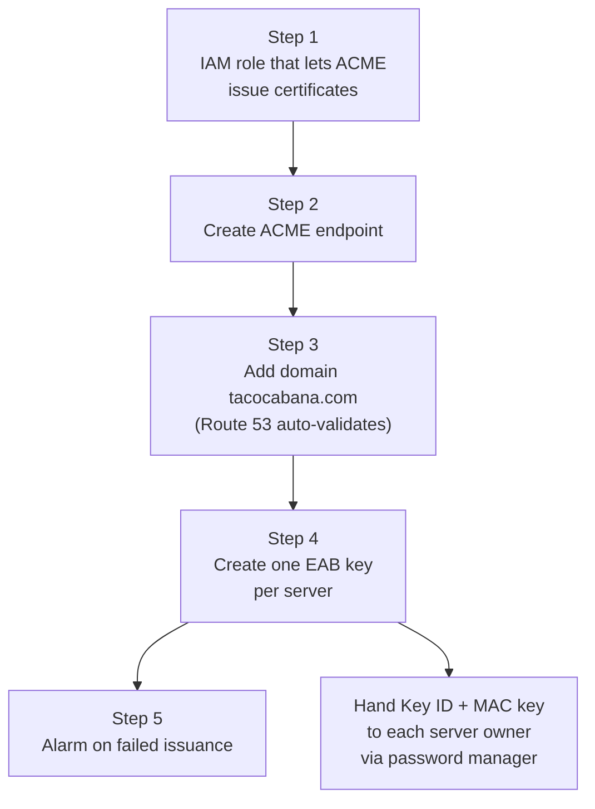

# Phase 1: Set up the AWS ACME endpoint (one-time, console only)

**Who:** someone with IAM admin and Certificate Manager access in the AWS console
**Time needed:** about 30–45 minutes
**Result:**
- An ACME directory URL.
- Our domain pre-approved.
- One EAB key per server, handed to the people who set up those servers ([file 3](3-linux-nginx-certbot.md) and [file 4](4-windows-servers.md)).

> **Region:** do everything in **US East (N. Virginia) us-east-1**, so it sits alongside the CloudFront certificates. Check the region selector at the top right of the console before every step.



---

## Step 1: Create the IAM role the endpoint uses

When a server requests a certificate, AWS performs the request using this role. **The role is not attached to any EC2 instance.** Only the ACME service uses it.

1. Go to **IAM** → **Roles** → **Create role**.
2. **Trusted entity type:** choose **Custom trust policy**, delete the sample text, and paste:
   ```json
   {
     "Version": "2012-10-17",
     "Statement": [
       {
         "Effect": "Allow",
         "Principal": { "Service": "acm-acme.amazonaws.com" },
         "Action": ["sts:AssumeRole", "sts:TagSession", "sts:SetSourceIdentity"],
         "Condition": { "StringLikeIfExists": { "sts:SourceIdentity": "acm-acme-*" } }
       }
     ]
   }
   ```
   Click **Next**.
3. On **Add permissions**, don't select anything. Click **Next**.
4. **Role name:** `tc-acme-issuance`. Click **Create role**.
5. Open the new role. Choose **Add permissions** → **Create inline policy**, switch to the **JSON** tab, and paste:
   ```json
   {
     "Version": "2012-10-17",
     "Statement": [
       {
         "Effect": "Allow",
         "Action": ["acm:RequestCertificate", "acm:RevokeCertificate", "acm:AddTagsToCertificate"],
         "Resource": "*"
       }
     ]
   }
   ```
   Click **Next**, name it `acme-request-certificates`, and click **Create policy**.

> `acm:AddTagsToCertificate` is only needed because Step 2 adds certificate tags. Leave it in.

## Step 2: Create the ACME endpoint

1. Go to **Certificate Manager**. In the left menu under **ACME**, choose **Endpoints** → **Create ACME endpoint**.
2. **Endpoint name:** `tacocabana-public`
3. **Endpoint type:** Public. This is fixed.
4. **Account email registration:** ✅ *Enable contact information during ACME account registration*. Each server will register with an email address, so we can tell the accounts apart.
5. **Certificate type:** Public. This is fixed.
6. **Certificate key types:** ✅ **ECDSA P-256** and ✅ **RSA 2048**. Linux uses ECDSA; RSA covers older Windows versions and appliances.
7. **Domains:** skip for now. You'll add them in Step 3.
8. **Certificate tags:** add `issued-by` = `acme-tacocabana-public`. This makes ACME-issued certificates easy to filter in the ACM list.
9. Click **Create ACME endpoint**. Wait for **Status = ACTIVE**.
10. On the endpoint's page, copy the **directory URL**. It looks like
    `https://acm-acme-enroll.us-east-1.api.aws/<id>/directory`.
    Save it in the team password manager or ops wiki. It isn't secret, but every server needs it.

## Step 3: Pre-approve the domain

This is the step that means servers never have to prove domain ownership themselves.

1. Find the Route 53 **Hosted zone ID**: go to **Route 53** → **Hosted zones** → `tacocabana.com` → **Hosted zone details** → **Hosted zone ID** (starts with `Z`). Copy it.
2. Back on the endpoint, open the **Domains** tab → **Add domain**.
3. **Domain name:** `tacocabana.com`
4. Scope:

   | Setting | Choice | Why |
   |---|---|---|
   | Exact domain | ✅ | `tacocabana.com` itself |
   | Subdomains | ✅ | `www.`, `marketing.`, `portal.`, etc. |
   | Wildcards | ✅ (see note) | The prod web server serves `*.marketing.tacocabana.com` for SendGrid. Leave this unchecked if we confirm that isn't needed. |

5. **Hosted zone ID:** paste the `Z...` value. ACM creates the DNS record for you.
6. Click **Add domain configuration**. Wait for **Status = VALID**. This usually takes minutes; ACM keeps checking for up to 72 hours.

> **Never delete the validation CNAME record** this creates in Route 53. Each ACME endpoint gets its own record, separate from the CloudFront certificate's.
>
> **CAA records:** we currently have none, which is fine. If anyone adds CAA records to `tacocabana.com` later, they **must** include `amazon.com`. Otherwise all issuance stops.

## Step 4: Create one EAB key per server

Repeat this for each server or device that will request certificates: `www-staging`, `prod-web`, each Windows server, and so on.

1. On the endpoint, open the **External account bindings** tab → **Create external account binding**.
2. **IAM role:** `tc-acme-issuance`
3. **Expiration:** **7 days**. The key is only used once, the first time the server registers. If the server owner doesn't use it within 7 days, create a new one.
4. **Tags:** `Name` = the server's name, e.g. `www-staging`, `prod-web`, `win-portal01`. This is our record of which key went where.
5. Click **Create**, then copy the **Key ID** and **MAC key**.
6. Put them in the password manager as an entry named e.g. *ACME EAB – www-staging*, along with the directory URL. Share that entry with the person setting up the server. **Never email or chat the MAC key.**

> The MAC key can be viewed again later if needed. The EAB's details page also shows **Last used**, which confirms the server registered.

## Step 5: Alert on failed issuance

1. Go to **CloudWatch** → **Alarms** → **Create alarm** → **Select metric**.
2. Choose **CertificateManager**, then the per-ACME-endpoint metrics, then **CertificateIssuanceFailed** for our endpoint. Click **Select metric**.
3. **Statistic:** Sum. **Period:** 1 day.
4. **Condition:** Greater than **0**. Click **Next**.
5. **Notification:** create an SNS topic (e.g. `it-cert-alerts`) with the IT distribution list's email. Confirm the subscription email when it arrives.
6. **Name:** `acme-issuance-failures`. Click **Create alarm**.

This alarm only covers failed requests. A server that *never asks* for a renewal (because it's broken or turned off) won't trigger it. That's covered by the expiry monitoring in [file 5](5-inventory-and-monitoring.md).

---

## Admin tasks later

| Task | How |
|---|---|
| Add a new server | Repeat Step 4 |
| A server is decommissioned or compromised | **Revoke** its EAB (External account bindings tab). This only stops *new* registrations. To also block the server's existing ACME account, use AWS CloudShell: `aws acm revoke-acme-account ...` (see AWS docs). |
| See every ACME-issued certificate | ACM → **Certificates** list or dashboard, filter by tag `issued-by` |
| See issuance graphs | ACM → ACME → Endpoints → our endpoint → **Monitoring** tab |

**Optional hardening, later:** a separate IAM role per server, with a condition on `acm:DomainNames`, so (for example) the staging EAB can only issue `www-staging.tacocabana.com`. See [ACM condition keys](https://docs.aws.amazon.com/acm/latest/userguide/acm-conditions.html).

## Checklist

- [ ] IAM role `tc-acme-issuance` created with trust policy and inline policy
- [ ] Endpoint `tacocabana-public` is ACTIVE; directory URL saved in the password manager
- [ ] Domain `tacocabana.com` is VALID
- [ ] EAB created for `www-staging` and stored in the password manager
- [ ] CloudWatch alarm `acme-issuance-failures` created; SNS email subscription confirmed
