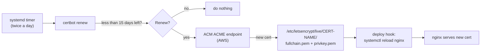

# Phases 2 and 3: Automatic certificates on the Linux web servers

**Who:** web admin with SSH access
**Before you start:**
- [Phase 1](2-aws-acme-endpoint-setup.md) is done.
- You have the **directory URL** and an **EAB Key ID + MAC key** for the server you're working on, from the password manager.
- Staging and prod each get their **own** EAB.

**Part A (staging) must pass before Part B (prod).**

## How it fits together on the server



- `certbot` is the same program staging already uses for Let's Encrypt. It can talk to any ACME server, so we point it at AWS instead.
- Certificates go into `/etc/letsencrypt/live/<name>/`. The folder is named `letsencrypt` for historical reasons. AWS-issued certificates go there too.
- nginx always reads from that folder, so **the nginx config is edited once and never again.**
- AWS certificates last **45 days**. We tell certbot to renew when **15 days** are left, so it renews around day 30 and has two weeks to retry if anything fails.

---

## Part A: Staging (`www-staging.tacocabana.com`, `18.116.129.11`)

### A1. Check certbot

```bash
certbot --version
snap list certbot 2>/dev/null || echo "not a snap install"
```

- **Version 2.0 or newer:** go to A2.
- **Older, or installed with `apt`:** switch to the snap version, which keeps itself up to date. Existing certificates in `/etc/letsencrypt` are kept.
  ```bash
  sudo apt remove certbot
  sudo snap install --classic certbot
  sudo ln -sf /snap/bin/certbot /usr/bin/certbot
  certbot --version
  ```

### A2. Get the first AWS certificate

Paste this as one command, replacing the three `<...>` values from the password manager:

```bash
sudo certbot certonly --nginx \
  --server "<DIRECTORY-URL>" \
  --eab-kid "<KEY-ID>" \
  --eab-hmac-key "<MAC-KEY>" \
  --email webadmin@tacocabana.com --agree-tos --no-eff-email \
  --cert-name www-staging-acm \
  --deploy-hook "systemctl reload nginx" \
  -d www-staging.tacocabana.com
```

Expect: `Successfully received certificate.` and a path under `/etc/letsencrypt/live/www-staging-acm/`.

What each option does:
- `certonly`: get the certificate only. certbot **won't touch the nginx config**; you'll edit that yourself in A4.
- `--nginx`: certbot requires a method for proving domain ownership. AWS has already approved the domain, so this isn't actually used.
- `--server`, `--eab-kid`, `--eab-hmac-key`: use AWS instead of Let's Encrypt. The EAB is used once, then certbot stores its own account.
- `--cert-name www-staging-acm`: a new folder name, so the existing Let's Encrypt cert keeps working while you test.
- `--deploy-hook`: after every successful renewal, reload nginx. This is saved for future renewals.

### A3. Set the renewal timing

```bash
sudo sed -i '1i renew_before_expiry = 15 days' /etc/letsencrypt/renewal/www-staging-acm.conf
sudo certbot certificates
```

`certbot certificates` should list `www-staging-acm` with **Expiry Date ... (VALID: 44 days)**, and the old Let's Encrypt certificate separately.

### A4. Point nginx at the new certificate

```bash
sudo cp /etc/nginx/sites-available/www-staging.tacocabana.com.conf ~/www-staging.conf.bak-$(date +%F)
sudo sed -i 's#/etc/letsencrypt/live/www-staging.tacocabana.com/#/etc/letsencrypt/live/www-staging-acm/#' \
  /etc/nginx/sites-available/www-staging.tacocabana.com.conf
grep -n ssl_certificate /etc/nginx/sites-available/www-staging.tacocabana.com.conf
sudo nginx -t && sudo systemctl reload nginx
```

The two `ssl_certificate` lines should now point to `/etc/letsencrypt/live/www-staging-acm/fullchain.pem` and `privkey.pem`. Make the same change in this repo's `sites-available/www-staging.tacocabana.com.conf`.

Check in a browser (with HTTPS filtering off): `https://www-staging.tacocabana.com` → padlock → certificate. It should be **issued by Amazon**, expiring in about 45 days.

### A5. Prove renewal works, end to end

This forces one real renewal now, instead of waiting 30 days. It costs about $1.

```bash
sudo certbot renew --cert-name www-staging-acm --force-renewal
sudo certbot certificates
systemctl list-timers | grep -i certbot
```

- The renewal should succeed, the **expiry date should move**, and nginx reloads automatically. Refresh the browser and the certificate details will have changed.
- The timer line should show `snap.certbot.renew.timer` (or `certbot.timer`) with a next run within 12 hours.

> Don't use `--dry-run` here. With a non-Let's Encrypt server it doesn't behave like a real test.

### A6. Let it renew by itself once

- Put a calendar reminder about **32 days** after A2.
- On that day, run `sudo certbot certificates` and check the expiry date moved forward **without anyone running anything**.
- Also check the ACM console → ACME → endpoint → **Monitoring** tab for the issuance.

### A7. Clean up (after A6 passes)

```bash
sudo certbot delete --cert-name www-staging.tacocabana.com   # the old Let's Encrypt one
```

**Rollback at any point:** restore `~/www-staging.conf.bak-<date>`, then run `sudo nginx -t && sudo systemctl reload nginx`.

---

## Part B: Production (`18.219.223.212`)

Start once A5 has passed. Ideally wait for A6 as well. Production must be done **before Apr 23 2027**, when the GoDaddy cert expires.

### B0. Confirm the hostnames

Prod nginx currently serves these names with SSL ([`sites-available/tacocabana.com.conf`](../sites-available/tacocabana.com.conf)):

| Name | Needed? |
|---|---|
| `www.tacocabana.com` | Yes, the main site |
| `marketing.tacocabana.com` | Yes, SendGrid click tracking |
| `email.tacocabana.com` | Yes, SendGrid click tracking |
| `*.marketing.tacocabana.com` | **Check with whoever manages SendGrid / Punchh.** If nothing uses sub-subdomains of `marketing.`, leave it out. That saves $5 per renewal and means the endpoint doesn't need wildcards. |
| `tacocabana.com` (apex) | No. CloudFront serves it ([file 1](1-now-replace-expiring-cert.md)), not nginx. |

### B1. Check certbot

Same as A1.

### B2. Get the certificate

Use the **prod** EAB:

```bash
sudo certbot certonly --nginx \
  --server "<DIRECTORY-URL>" \
  --eab-kid "<PROD-KEY-ID>" \
  --eab-hmac-key "<PROD-MAC-KEY>" \
  --email webadmin@tacocabana.com --agree-tos --no-eff-email \
  --cert-name tacocabana-prod \
  --deploy-hook "systemctl reload nginx" \
  -d www.tacocabana.com \
  -d marketing.tacocabana.com \
  -d email.tacocabana.com \
  -d '*.marketing.tacocabana.com'
sudo sed -i '1i renew_before_expiry = 15 days' /etc/letsencrypt/renewal/tacocabana-prod.conf
sudo certbot certificates
```

Drop the last `-d` line if B0 said it isn't needed.

### B3. Point nginx at it

In `/etc/nginx/sites-available/tacocabana.com.conf` there are **two** pairs of certificate lines: the SendGrid/marketing block and the main site block. Change both pairs to:

```nginx
    ssl_certificate /etc/letsencrypt/live/tacocabana-prod/fullchain.pem;
    ssl_certificate_key /etc/letsencrypt/live/tacocabana-prod/privkey.pem;
```

Do it with:

```bash
sudo cp /etc/nginx/sites-available/tacocabana.com.conf ~/tacocabana.com.conf.bak-$(date +%F)
sudo sed -i \
  -e 's#ssl_certificate /etc/ssl/certs/tc.com-2027-fullchain.crt;#ssl_certificate /etc/letsencrypt/live/tacocabana-prod/fullchain.pem;#' \
  -e 's#ssl_certificate_key /etc/ssl/private/threeyear.tacocabana.com.key;#ssl_certificate_key /etc/letsencrypt/live/tacocabana-prod/privkey.pem;#' \
  /etc/nginx/sites-available/tacocabana.com.conf
grep -n ssl_certificate /etc/nginx/sites-available/tacocabana.com.conf
sudo nginx -t && sudo systemctl reload nginx
```

`grep` should show **four** lines, all under `/etc/letsencrypt/live/tacocabana-prod/`. Make the same change in this repo.

### B4. Verify and test renewal

1. In a browser, check `www.`, `marketing.` and `email.tacocabana.com`. Each should show a certificate **issued by Amazon**.
2. Run [SSL Labs](https://www.ssllabs.com/ssltest/) on `www.tacocabana.com`. It should show no chain issues.
3. Run `sudo certbot renew --cert-name tacocabana-prod --force-renewal` once and confirm the site still works.

### B5. Leave the GoDaddy files in place until Apr 23 2027

`/etc/ssl/certs/tc.com-2027-fullchain.crt` and `/etc/ssl/private/threeyear.tacocabana.com.key` are the rollback. Restoring the backup config switches back instantly. Delete them after Apr 23 2027.

---

## Troubleshooting

| Error contains | Meaning / fix |
|---|---|
| `externalAccountRequired` | The `--eab-kid` / `--eab-hmac-key` options are missing or mistyped |
| `unauthorized`, `rejectedIdentifier`, or `does not support any combination of challenges` | AWS is asking certbot to prove ownership, which means the name isn't pre-approved. Check the endpoint's **Domains** tab: status VALID, and **Wildcards** enabled if you requested a `*.` name. |
| `badPublicKey` / key type not allowed | The endpoint's **Certificate key types** doesn't include ECDSA P-256. Add it, or add `--key-type rsa` to the command. |
| EAB rejected / expired | EABs expire after 7 days if unused. Create a new one (Phase 1, Step 4). |
| `nginx -t` fails after editing | A typo in the path. Restore the backup config, run `nginx -t` again, and reload. |
| Browser shows "AdGuard" or a company proxy as the issuer | Your PC's HTTPS filter is replacing the certificate. Check from another device or turn the filter off. |

## Checklist

- [ ] A2 staging cert issued
- [ ] A4 staging nginx switched and verified in a browser
- [ ] A5 forced renewal worked and nginx reloaded by itself
- [ ] A6 staging renewed on its own (~30 days later)
- [ ] B0 hostnames confirmed with the SendGrid owner
- [ ] B2–B4 prod switched, verified, and forced renewal tested
- [ ] Repo configs updated to match the servers
