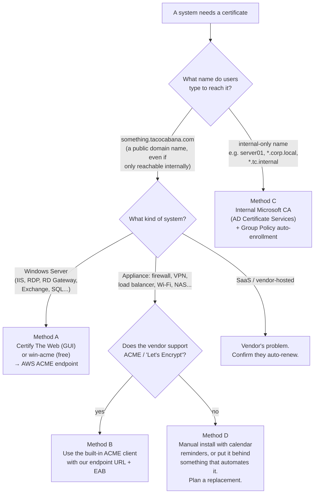

# Phase 4: Windows servers and other internal systems

**Who:** sys admin
**Goal:** every Windows server and device gets its own certificate and renews it with no one involved. **No more passing the wildcard `.pfx` around.**

## Step 1: Decide the method for each system



**Why the name matters:**
- Public certificates (GoDaddy, Amazon, Let's Encrypt) can only be issued for names under a domain we own, like `tacocabana.com`.
- Names like `server01` or `something.corp.local` can't get a public certificate at all. Those need our own internal CA, which **isn't** affected by the shrinking-lifetime rules.

**The server does not need to be reachable from the internet** for Method A or B. It only needs **outbound HTTPS (port 443)** to `acm-acme-enroll.us-east-1.api.aws`. Ask for a firewall rule if outbound traffic is restricted.

---

## Method A1: Certify The Web (recommended for a point-and-click setup)

[Certify The Web](https://certifytheweb.com) is a Windows desktop app with a background service that renews certificates and installs them in IIS (and other places) automatically.

- **License:** the free Community edition is for evaluation, up to 5 certificates per server. For business use, buy a license (**$59/server Starter**, or bundles for more servers).
- Menu labels below may differ slightly between versions.

**Before you start:** get from the password manager:
- the ACME **directory URL**,
- an **EAB Key ID + MAC key created for this server** ([Phase 1, Step 4](2-aws-acme-endpoint-setup.md#step-4-create-one-eab-key-per-server)).

1. **Install.** Download Certify Certificate Manager from certifytheweb.com and run the installer as an administrator.
2. **Add our AWS endpoint as a certificate authority.**
   1. Open **Settings** → **Certificate Authorities** → **Edit Certificate Authorities**.
   2. Add a new custom CA:
      - **Title:** `AWS ACM - tacocabana`
      - **Production directory URL:** the directory URL
      - Mark it as **requiring External Account Binding** and **supporting wildcards**.
   3. Save.
3. **Register an account with it.**
   1. In **Settings** → **Certificate Authorities**, choose **New Account**.
   2. Select `AWS ACM - tacocabana` and enter the IT team email.
   3. Expand **Advanced** and enter **EAB Key Id** = Key ID and **EAB Key** = MAC key.
   4. Register.
   5. Make this the **default / preferred** certificate authority.
4. **Create the certificate.** Click **New Certificate**:
   - **Certificate** tab: pick the IIS site, which fills in its hostnames, or type the hostname(s), e.g. `portal.tacocabana.com`. Only include names this server actually serves.
   - **Authorization** tab: leave the default. AWS has already approved our domain, so no challenge runs.
   - **Deployment** tab:
     - **IIS:** choose **Auto**. It updates the site's HTTPS binding.
     - **Not IIS** (RDP, RD Gateway, Exchange, SQL Server, etc.): choose **Certificate Store** and add the matching **Deployment Task**. Certify has built-in tasks for RDP, RD Gateway, Exchange and others.
   - Save, then click **Request Certificate**.
5. **Renewal timing.** In **Settings**, set renewal to happen when about **15 days remain**, or at roughly **2/3 of the certificate's lifetime**. Our AWS certificates last 45 days.
6. **Verify.** Browse to the site and check the certificate is issued by **Amazon**. In Certify, the certificate should show a green status and a next renewal date.

## Method A2: win-acme (free, menu-driven)

[win-acme](https://www.win-acme.com) is free, open-source and widely used. It runs as a text menu instead of a GUI, and creates a Windows Scheduled Task to handle renewals.

1. Download the **x64 trimmed** zip from win-acme.com and extract it to `C:\Tools\win-acme`.
2. Open `settings.json` and set **`ScheduledTask` → `RenewalDays`** to **`30`**. The default is longer than our 45-day certificates.
3. Open an **administrator** Command Prompt in that folder and run:
   ```
   wacs.exe --baseuri "<DIRECTORY-URL>"
   ```
4. Choose **M: Create certificate (full options)**, then:
   - When asked for **External Account Binding**, enter the Key ID and MAC key.
   - **Source:** your IIS site, or **Manual input** to type hostnames.
   - **Validation:** keep the default. It isn't used, because the domain is pre-approved.
   - **Store:** Windows Certificate Store.
   - **Installation:** IIS. For other services, choose a script step, and see win-acme's docs for RDP/Exchange examples.
5. Let it create the **Scheduled Task**. Check it in Task Scheduler as **win-acme renew**.

## Method B: Appliances with built-in ACME

Many current firewalls, VPNs and load balancers have an ACME or "Let's Encrypt" option. Examples are FortiGate, Citrix NetScaler, F5, pfSense, Synology and Kemp. Check the vendor's docs for **"ACME server URL"** or **"External Account Binding"**. If both are supported, enter our directory URL and a dedicated EAB.

If the device only supports Let's Encrypt with no custom server option, Let's Encrypt is acceptable for that device, provided it can complete the challenge. Note it in the inventory.

## Method C: Internal-only names with AD Certificate Services

For servers reached by internal names only (`*.corp.local`, short names, etc.):

1. Set up an **Enterprise CA** with AD Certificate Services, if we don't already have one.
2. Duplicate the **Web Server** or **Computer** certificate template, then allow **Enroll** and **Autoenroll** for the right server group.
3. In Group Policy, go to **Computer Configuration → Policies → Windows Settings → Security Settings → Public Key Policies → Certificate Services Client – Auto-Enrollment**. Set it to **Enabled**, and tick **Renew expired certificates** and **Update certificates that use certificate templates**.

Domain-joined machines already trust this CA, and they renew automatically. See Microsoft's "Configure certificate auto-enrollment" documentation for the full walkthrough.

## Method D: Can't be automated

- Install the certificate manually and add the device to the monitoring list in [file 5](5-inventory-and-monitoring.md).
- Put **two** calendar reminders on the team calendar, 30 and 14 days before expiry.
- From Mar 15 2027 this will be needed about every 3 months, so plan to replace the device or put it behind something that automates certificates.

---

## What to send back for the inventory

For each system, fill in a row in [file 5](5-inventory-and-monitoring.md):

- hostname(s) users type,
- the server or device,
- the method (A1 / A2 / B / C / D),
- the owner,
- the date automation was confirmed working.

## Checklist (per server)

- [ ] Method chosen
- [ ] EAB created for this server (Methods A and B only)
- [ ] Outbound 443 to `acm-acme-enroll.us-east-1.api.aws` allowed
- [ ] Certificate issued and installed, browser shows **Amazon** as issuer
- [ ] Renewal schedule confirmed (Certify status or win-acme scheduled task)
- [ ] Old GoDaddy wildcard removed from the server's certificate store (`certlm.msc` → Personal → Certificates), **after** the new one is confirmed working
- [ ] Inventory row updated
