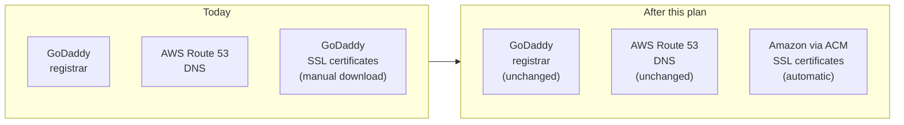
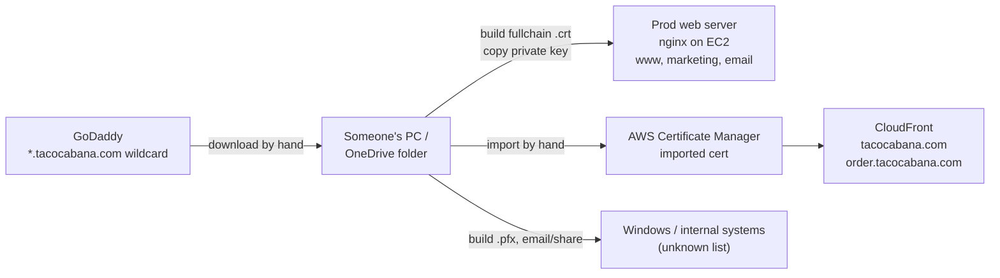
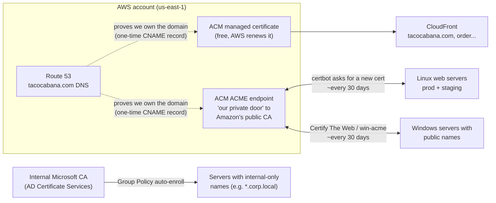
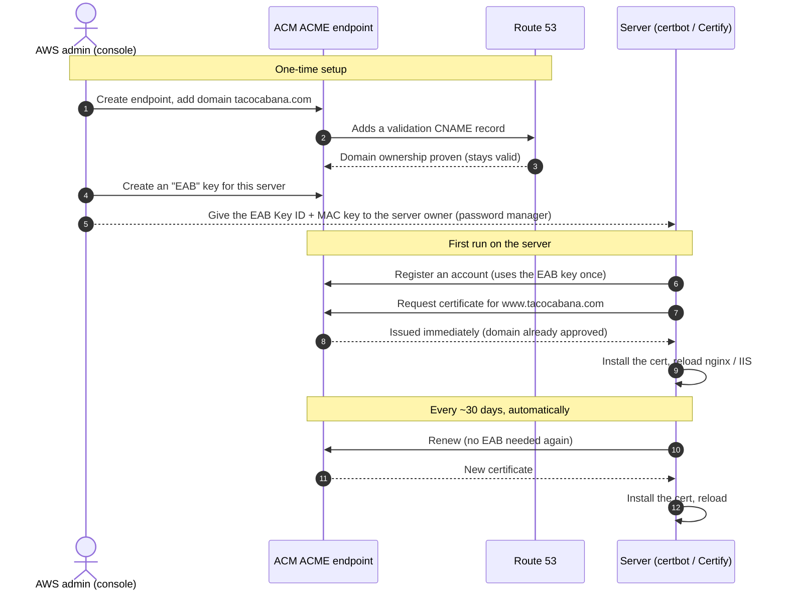
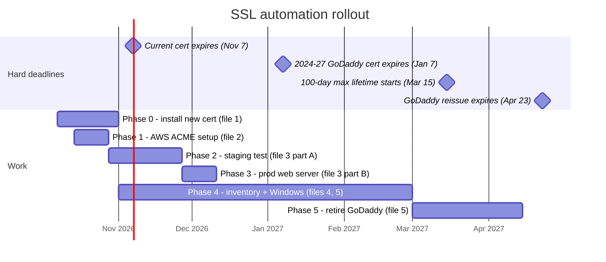

# SSL Certificate Automation Plan

**Status:** Draft, October 7 2026 **Scope:** Every system that serves HTTPS for `tacocabana.com` names: the public website, CloudFront, and internal or Windows servers.

> The diagrams use Mermaid. They render on GitHub, GitLab and Azure DevOps, and in VS Code with the "Markdown Preview Mermaid Support" extension.

## Start here: SSL certificates in plain English

### How can Amazon or Let's Encrypt issue a certificate for "our GoDaddy domain"?

Every certificate authority follows the same rule before issuing a certificate: **prove you control the domain.** The rules (from the CA/Browser Forum) are the same for every CA, and there are three standard ways to prove it:

| Proof method | How it works |
| --- | --- |
| **DNS record** | The CA says "add this random code as a DNS record." Only someone who controls the domain's DNS can do that. |
| **File on the website** | The CA says "put this random code at `http://www.tacocabana.com/.well-known/...`." Only someone who controls the website can do that. |
| **Email** | The CA emails `admin@tacocabana.com` or similar with a link to click |

GoDaddy made us do one of these when we first bought the certificate. Amazon and Let's Encrypt do exactly the same thing. **That's the only thing that connects a certificate to a domain: proof of control, not who sold you the domain.**

For us the DNS method is easy, because our DNS is already in AWS Route 53. The AWS console has a button ("Create records in Route 53") that adds the proof record for us.

### Where ACME fits

- **The old way (manual).** Log into GoDaddy's website → click to renew → download the certificate files → combine them into the "fullchain" file nginx needs → upload to the server → edit the config → reload. Repeat for every server, every time the certificate is renewed.
- **ACME** is a standard "language" that lets a **program on the server** do all of that itself, without a person or a website.
  - The program on Linux is called **certbot**. On Windows it's **Certify The Web** or **win-acme**.
  - It creates the key, asks the CA for a certificate, receives it **already combined** into the fullchain file, saves it where nginx reads it, and reloads nginx. It repeats this automatically before each expiry.
- **Let's Encrypt** is a free CA that _only_ works through ACME. It's why ACME became popular.
- **AWS's "ACME" feature** (ACM console → ACME) is Amazon offering the same thing, privately for our AWS account. In short, it's "the AWS version of Let's Encrypt."
- **GoDaddy also offers ACME** for paid certificates. It's in the GoDaddy account under SSL → ACME Automation.

certbot isn't tied to any CA. **You choose the CA by giving certbot that CA's ACME web address.** Same program, same server setup, just a different address:

| certbot is pointed at | Certificate says "Issued by" | Cost |
| --- | --- | --- |
| Let's Encrypt (the default) | Let's Encrypt | Free |
| Our AWS ACME endpoint (this plan) | Amazon | ~$1 per hostname per certificate |
| GoDaddy's ACME address | GoDaddy | Our existing subscription |

Visitors see the same padlock whichever CA issued the certificate.

### So can we stop using GoDaddy for certificates?

**Yes, and we don't have to wait until 2028.**

- **Certificates:** move to AWS (or Let's Encrypt) whenever each server is ready. The GoDaddy SSL subscription simply goes unused, and we can cancel it or let it lapse.
- **Domain registration:** **stays at GoDaddy.** It's unrelated to certificates and must keep being renewed, or the whole domain stops working. It's currently due **Nov 9 2026**, so make sure auto-renew is on.
- **DNS:** already in AWS Route 53. Nothing changes.

## Contents

| File | What it covers | Who does it |
| --- | --- | --- |
| [1-now-replace-expiring-cert.md](1-now-replace-expiring-cert.md) | Install the new cert before the current one expires on **Nov 7 2026** | Web admin |
| [2-aws-acme-endpoint-setup.md](2-aws-acme-endpoint-setup.md) | One-time AWS console setup of our own certificate authority endpoint (ACME) | AWS admin |
| [3-linux-nginx-certbot.md](3-linux-nginx-certbot.md) | Automatic renewal on the staging, then production, web servers | Web admin |
| [4-windows-servers.md](4-windows-servers.md) | Automatic renewal on Windows servers, plus what to do with internal-only names | Sys admin |
| [5-inventory-and-monitoring.md](5-inventory-and-monitoring.md) | What uses certificates today, alerts, and retiring GoDaddy | Everyone |

---

## Why we're doing this

The browser and certificate-authority industry group (the CA/Browser Forum) voted in ballot SC-081 to shorten how long an SSL certificate can last:

| Starting              | Maximum certificate lifetime | Manual installs per system per year |
| --------------------- | ---------------------------- | ----------------------------------- |
| Before Mar 15 2026    | 398 days                     | 1                                   |
| **Mar 15 2026** (now) | 200 days                     | ~2                                  |
| **Mar 15 2027**       | 100 days                     | ~4                                  |
| **Mar 15 2029**       | 47 days                      | ~8–12                               |

Right now we buy one GoDaddy wildcard certificate (`*.tacocabana.com`). Each time it renews, someone does all of this by hand:

1. Downloads it from GoDaddy.
2. Builds the nginx file and the Windows `.pfx` file.
3. Copies the private key to every system.
4. Installs it on each system.

At 47 days, that's a job every 5–6 weeks on every system. If one is missed, that site breaks for customers.

The GoDaddy email about "certificate subscriptions" and 198-day certificates was legitimate. It was GoDaddy's response to this rule change.

## Where we are today

Problems with this setup:

- **Every step is manual.** Nothing tells us when a system was missed.
- **One private key is copied to many places**, including at least one OneDrive folder. Anyone with that key can impersonate _any_ `tacocabana.com` website.
- **We pay for two GoDaddy wildcard subscriptions** that do the same job. The 2024–2027 one isn't used on any public site we could find.

## Where we're going

Every system gets **its own certificate, for its own name, and renews it automatically**. Nothing gets copied from one system to another.

| System type | How it gets certificates | Who renews | Cost |
| --- | --- | --- | --- |
| CloudFront (apex `tacocabana.com`, `order.`) | ACM **requested** public certificate | AWS, automatically | Free |
| Linux web servers (prod and staging nginx) | `certbot` → ACM ACME endpoint | certbot's timer on the server | ~$1 per hostname, $5 per wildcard, per certificate issued |
| Windows servers with public `*.tacocabana.com` names | Certify The Web or win-acme → ACM ACME endpoint | Windows service or scheduled task | Same as above, plus a Certify license if used |
| Servers with internal-only names | Microsoft AD Certificate Services | Windows Group Policy | Free. These rules don't apply to internal CAs. |
| Appliances (firewalls, VPN, etc.) | Built-in ACME support if the vendor has it; otherwise manual | Device, or a person | Varies |

## How the AWS "ACME" feature works (the part that's new)

AWS added this to Certificate Manager in July 2026. In the ACM console, it's the **ACME** section in the left menu.

**ACME** is the standard protocol that software like `certbot` uses to request certificates automatically. Let's Encrypt made it popular. AWS now runs a private ACME server for our account, which issues publicly trusted certificates from Amazon.

The important part: **AWS checks that we own `tacocabana.com` once, centrally**, using a DNS record in Route 53. After that, servers never have to prove anything themselves. That means a server **does not need**:

- the AWS CLI,
- an IAM role or AWS access keys,
- access to change DNS,
- to be reachable from the internet. It only needs to make **outbound** HTTPS calls to AWS.

An **EAB** ("External Account Binding") is a one-time sign-up key: a **Key ID** and a **MAC key**. It's the only secret a server needs. It works like a password that says "this server may request certificates from our endpoint." We'll create a separate one for each server so we can track which server is which and shut one off without affecting the others.

## Phases and deadlines

| Phase | Goal | Done when |
| --- | --- | --- |
| 0 | Nothing breaks on Nov 7 | Prod nginx and CloudFront serve a cert expiring after Nov 7 |
| 1 | AWS ACME endpoint ready | Endpoint `ACTIVE`, domain `VALID`, alarm created |
| 2 | Prove it works on staging | Staging renewed itself at least once with no one touching it |
| 3 | Production automated | Prod nginx serves an Amazon-issued cert and the renewal test passes |
| 4 | Everything else | Every row in the inventory has an automated method or a named owner |
| 5 | GoDaddy retired | Nothing uses GoDaddy certs, subscriptions cancelled |

**Fallback:** the GoDaddy cert reissued Oct 7 2026 is valid until **Apr 23 2027**. Any system not automated by then needs another manual GoDaddy install, and that reissue would be limited to 100 days.

## Costs (from AWS pricing, October 2026)

- **CloudFront certificates (ACM requested):** free.
- **ACME certificates:** charged each time a certificate is issued. **$1 per hostname** and **$5 per wildcard name** on that certificate. They last 45 days and we renew around day 30, so expect about 12 issuances per year.
  - Prod web server cert (3 hostnames + 1 wildcard): ~$8 × 12 ≈ **$96/year**.
  - A Windows server with one name: ~$1 × 12 ≈ **$12/year**.
- **Certify The Web** (Windows GUI tool): free for evaluation, from **$59 per server** licensed. **win-acme** is free.
- **Savings:** both GoDaddy wildcard subscriptions can be dropped once everything is migrated.

**Free alternative:** Let's Encrypt works with the same tools (staging already uses it). The catch is that every server must prove domain ownership itself. That means opening port 80 to the internet, or giving each server permission to edit Route 53 DNS. For internal servers that's worse for security and harder to set up, which is why ACM ACME is the main plan.

## FAQ

**Do I need to update CloudFront and nginx at the same time?** No. The old and new GoDaddy certs use the same private key, and both are valid until Nov 7. Update them in any order, any time before then.

**Does the EC2 server need the AWS CLI or an IAM role for this?** No. certbot on the server only talks to the ACME endpoint URL, using the EAB key the first time. The AWS side is set up entirely in the console.

**What if AWS is down when a renewal is due?** Renewal starts about 15 days before expiry, and certbot retries twice a day. Monitoring (file 5) alerts us long before anything expires.

**Is the EAB key sensitive?** Yes. Anyone holding it can get a valid certificate for any `tacocabana.com` name on our endpoint. Store it in the password manager and give each server its own key. Set keys to expire after 7 days, because a server only needs its key once, at first registration.

**Why not keep one wildcard and copy it around with a script?** Every copy of the wildcard private key is a way to impersonate all of our sites. And a copy script still fails silently when one target is offline. Giving each system its own certificate avoids both problems.

**I don't have the AWS CLI. What if a step needs it?** Use **AWS CloudShell**, the terminal icon in the AWS console's top bar. It already has the AWS CLI and your console permissions. Nothing in the main plan needs it.

## Glossary

| Term | Meaning |
| --- | --- |
| Certificate (`.crt`, `.pem`) | Public file that proves a server is `www.tacocabana.com`. Safe to share. |
| Private key (`.key`) | Secret that matches the certificate. **Never share or email it.** |
| Full chain | The certificate plus the CA's intermediate certificates in one file. nginx needs this. |
| PFX / `.p12` | Windows bundle of certificate + chain + private key, protected by a password |
| Wildcard | A certificate for `*.tacocabana.com`: any single-level subdomain |
| CA | Certificate Authority: GoDaddy, Let's Encrypt, Amazon, etc. |
| ACM | AWS Certificate Manager |
| ACME | Standard protocol for requesting and renewing certificates automatically |
| EAB | External Account Binding: the one-time key that lets a server sign up with our ACME endpoint |
| certbot | ACME program for Linux. Already installed on staging. |
| Certify The Web / win-acme | ACME programs for Windows (GUI and menu-driven) |

## References

- [AWS: ACM now supports ACME (announcement)](https://aws.amazon.com/about-aws/whats-new/2026/07/aws-certificate-manager-acme/)
- [AWS blog: Automate certificates with ACME support in ACM](https://aws.amazon.com/blogs/security/automate-certificates-with-acme-support-in-aws-certificate-manager/)
- [ACM docs: ACME endpoints](https://docs.aws.amazon.com/acm/latest/userguide/acm-acme-endpoints.html), [domain validation](https://docs.aws.amazon.com/acm/latest/userguide/acm-acme-domain-validation.html), [external account bindings](https://docs.aws.amazon.com/acm/latest/userguide/acm-acme-eab.html), [IAM](https://docs.aws.amazon.com/acm/latest/userguide/security-iam-acme.html)
- [ACM pricing](https://aws.amazon.com/certificate-manager/pricing/)
- [Certify The Web pricing](https://certifytheweb.com/upgrade)
